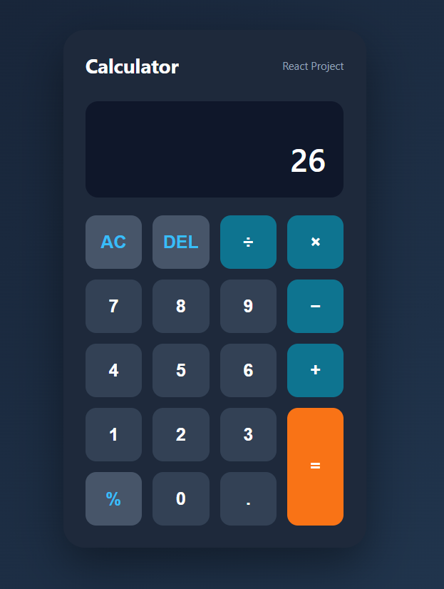

# Ex04 Simple Calculator - React Project
## Date:20-11-2026
## Name : DEEPIKA A.
## Reg No : 212225040058

## AIM
To  develop a Simple Calculator using React.js with clean and responsive design, ensuring a smooth user experience across different screen sizes.

## ALGORITHM
### STEP 1
Create a React App.

### STEP 2
Open a terminal and run:
  <ul><li>npx create-react-app simple-calculator</li>
  <li>cd simple-calculator</li>
  <li>npm start</li></ul>

### STEP 3
Inside the src/ folder, create a new file Calculator.js and define the basic structure.

### STEP 4
Plan the UI: Display screen, number buttons (0-9), operators (+, -, *, /), clear (C), and equal (=).

### STEP 5
Create a new file Calculator.css in src/ and add the styling.

### STEP 6
Open src/App.js and modify it.

### STEP 7
Start the development server.
  npm start

### STEP 8
Open http://localhost:3000/ in the browser.

### STEP 9
Test the calculator by entering numbers and operations.

### STEP 10
Fix styling issues and refine content placement.

### STEP 11
Deploy the website.

### STEP 12
Upload to GitHub Pages for free hosting.

## PROGRAM

### main.jsx
```
import React from 'react'
import ReactDOM from 'react-dom/client'
import App from './App'
import './index.css'

ReactDOM.createRoot(document.getElementById('root')).render(
  <React.StrictMode>
    <App />
  </React.StrictMode>
)
```
### App.jsx
```
import Calculator from './components/Calculator'
import './App.css'

function App() {
  return (
    <div className="app">
      <Calculator />
    </div>
  )
}

export default App
```

### App.css
```
.app {
  min-height: 100vh;
  display: flex;
  justify-content: center;
  align-items: center;
  padding: 20px;
}
```

### index.css
```
* {
  margin: 0;
  padding: 0;
  box-sizing: border-box;
}

body {
  font-family: 'Segoe UI', sans-serif;
  background: linear-gradient(135deg, #141e30, #243b55);
  min-height: 100vh;
}
```

### Calculator.jsx
```
import { useState } from 'react'
import './Calculator.css'
function Calculator() {
  const [display, setDisplay] = useState('0')
  const [previousValue, setPreviousValue] = useState(null)
  const [operator, setOperator] = useState(null)
  const [waitingForOperand, setWaitingForOperand] = useState(false)

  const handleNumber = (number) => {
    if (display === 'Error') {
      setDisplay(number)
      return
    }

    if (waitingForOperand) {
      setDisplay(number)
      setWaitingForOperand(false)
    } else {
      setDisplay(display === '0' ? number : display + number)
    }
  }

  const handleDecimal = () => {
    if (display === 'Error') {
      setDisplay('0.')
      return
    }

    if (waitingForOperand) {
      setDisplay('0.')
      setWaitingForOperand(false)
      return
    }

    if (!display.includes('.')) {
      setDisplay(display + '.')
    }
  }

  const calculate = (a, b, op) => {
    switch (op) {
      case '+': return a + b
      case '-': return a - b
      case '*': return a * b
      case '/': return b === 0 ? 'Error' : a / b
      default: return b
    }
  }

  const handleOperator = (nextOperator) => {
    if (display === 'Error') return

    const inputValue = Number(display)

    if (operator && !waitingForOperand) {
      const result = calculate(previousValue, inputValue, operator)

      if (result === 'Error' || !Number.isFinite(result)) {
        setDisplay('Error')
        setPreviousValue(null)
        setOperator(null)
        setWaitingForOperand(true)
        return
      }

      setDisplay(String(Number(result.toPrecision(12))))
      setPreviousValue(result)
    } else {
      setPreviousValue(inputValue)
    }

    setOperator(nextOperator)
    setWaitingForOperand(true)
  }

  const handleEqual = () => {
    if (!operator || previousValue === null || waitingForOperand) return

    const result = calculate(
      previousValue,
      Number(display),
      operator
    )

    if (result === 'Error' || !Number.isFinite(result)) {
      setDisplay('Error')
    } else {
      setDisplay(String(Number(result.toPrecision(12))))
    }

    setPreviousValue(null)
    setOperator(null)
    setWaitingForOperand(true)
  }

  const handleClear = () => {
    setDisplay('0')
    setPreviousValue(null)
    setOperator(null)
    setWaitingForOperand(false)
  }

  const handleDelete = () => {
    if (display === 'Error' || waitingForOperand) {
      setDisplay('0')
      setWaitingForOperand(false)
      return
    }

    setDisplay(display.length > 1 ? display.slice(0, -1) : '0')
  }

  const buttons = [
    { label: 'AC', type: 'utility', action: handleClear },
    { label: 'DEL', type: 'utility', action: handleDelete },
    { label: '÷', type: 'operator', action: () => handleOperator('/') },
    { label: '×', type: 'operator', action: () => handleOperator('*') },

    { label: '7', type: 'number', action: () => handleNumber('7') },
    { label: '8', type: 'number', action: () => handleNumber('8') },
    { label: '9', type: 'number', action: () => handleNumber('9') },
    { label: '−', type: 'operator', action: () => handleOperator('-') },

    { label: '4', type: 'number', action: () => handleNumber('4') },
    { label: '5', type: 'number', action: () => handleNumber('5') },
    { label: '6', type: 'number', action: () => handleNumber('6') },
    { label: '+', type: 'operator', action: () => handleOperator('+') },

    { label: '1', type: 'number', action: () => handleNumber('1') },
    { label: '2', type: 'number', action: () => handleNumber('2') },
    { label: '3', type: 'number', action: () => handleNumber('3') },
    { label: '=', type: 'equal', action: handleEqual },

    { label: '%', type: 'utility', action: () => {
      if (display !== 'Error') {
        setDisplay(String(Number(display) / 100))
      }
    }},
    { label: '0', type: 'number', action: () => handleNumber('0') },
    { label: '.', type: 'number', action: handleDecimal },
  ]

  return (
    <div className="calculator">
      <div className="calculator-header">
        <h2>Calculator</h2>
        <span>React Project</span>
      </div>

      <div className="display">
        <span className="expression">
          {previousValue !== null && operator
            ? `${previousValue} ${operator}`
            : ''}
        </span>

        <div className="display-value" title={display}>
          {display}
        </div>
      </div>

      <div className="buttons">
        {buttons.map((button, index) => (
          <button
            key={index}
            className={`btn ${button.type} ${
              operator && button.label ===
              ({ '+': '+', '-': '−', '*': '×', '/': '÷' }[operator])
                ? 'active'
                : ''
            }`}
            onClick={button.action}
          >
            {button.label}
          </button>
        ))}
      </div>
    </div>
  )
}

export default Calculator
```

### Calculator.css
```
.calculator {
  width: 340px;
  padding: 25px;
  background: #1e293b;
  border-radius: 24px;
  box-shadow: 0 20px 50px rgba(0, 0, 0, 0.4);
  color: white;
}

.calculator-header {
  display: flex;
  justify-content: space-between;
  align-items: center;
  margin-bottom: 25px;
}

.calculator-header h2 {
  font-size: 22px;
}

.calculator-header span {
  font-size: 12px;
  color: #94a3b8;
}

.display {
  background: #0f172a;
  padding: 20px;
  border-radius: 14px;
  margin-bottom: 20px;
  text-align: right;
  min-width: 0;
}

.expression {
  display: block;
  min-height: 20px;
  color: #94a3b8;
  font-size: 14px;
}

.display-value {
  font-size: 36px;
  font-weight: 600;
  overflow: hidden;
  text-overflow: ellipsis;
  white-space: nowrap;
}

.buttons {
  display: grid;
  grid-template-columns: repeat(4, 1fr);
  gap: 12px;
}

.btn {
  height: 60px;
  border: none;
  border-radius: 12px;
  font-size: 20px;
  font-weight: 600;
  cursor: pointer;
  transition: 0.2s;
  background: #334155;
  color: white;
}

.btn:hover {
  filter: brightness(1.25);
  transform: translateY(-2px);
}

.btn:active {
  transform: scale(0.95);
}

.btn.utility {
  background: #475569;
  color: #38bdf8;
}

.btn.operator {
  background: #0e7490;
  color: white;
}

.btn.operator.active {
  background: #06b6d4;
}

.btn.equal {
  background: #f97316;
  color: white;
  grid-row: span 2;
  height: auto;
}

.btn.number {
  background: #334155;
}

@media (max-width: 400px) {
  .calculator {
    width: 100%;
    padding: 18px;
  }
}
```
## OUTPUT


## RESULT
The program for developing a simple calculator in React.js is executed successfully.
